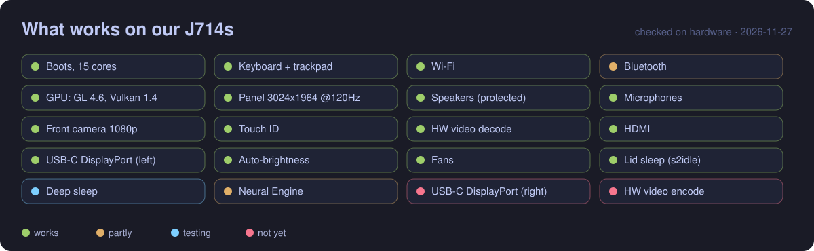

<p align="center">
  
</p>

<p align="center">
<a href="https://github.com/betizzel/omarchy-m5/stargazers"></a> <a href="https://github.com/betizzel/omarchy-m5/watchers"></a> <a href="tools/update-source/README.md"></a> <a href="docs/news.md"></a> <a href="https://github.com/betizzel/omarchy-m5/releases"></a> <a href="https://github.com/betizzel/omarchy-m5/commits/main"></a> <a href="LICENSE"></a>
</p>

<p align="center">
  <a href="#the-goal">Goal</a> ·
  <a href="#get-updates">Get updates</a> ·
  <a href="docs/news.md">What's new</a> ·
  <a href="docs/what-works.md">What works</a> ·
  <a href="docs/install.md">Install</a> ·
  <a href="docs/todo.md">TODO</a> ·
  <a href="docs/credits.md">Credits</a> ·
  <a href="CONTRIBUTING.md">Send your work</a>
</p>

## The goal

**Omarchy on the M5 Pro MacBook Pro, working like a normal laptop, through plain `omarchy update`.**

We don't reinvent anything. A lot of people are getting Linux running on the M5 Macs, each in their own repo. We
collect the parts that already work, test them on a real J714s, ship them as one signed update, and say who made
each part. When their pull request lands upstream, our copy goes away.

<p align="center"></p>

## Get updates

```sh
curl -fsSLO https://raw.githubusercontent.com/betizzel/omarchy-m5/main/tools/update-source/enable
bash enable        # once: adds the signed [omarchy-m5] repo
omarchy update     # from then on, like any other package
```

Turned it on before 2026-11-27? Run `bash enable` once more to get the GPU drivers.
[What it does and why it's safe](tools/update-source/README.md). New to all this? [Install guide](docs/install.md).

## Latest

| | |
| --- | --- |
| **GPU acceleration** | OpenGL 4.6 and Vulkan 1.4 on the M5 Pro's GPU; the desktop renders on it (glmark2 3003 against 89) |
| **Microphones** | about 17 dB louder, from Isaac-Duarte's fix |
| **Wi-Fi power save** | on by default, about -0.35 W (erikwb's measurement) |
| **Kernel v272-24** | the M5 Pro deep sleep driver, opt-in for now; lid sleep stays s2idle |

All of it through `omarchy update` since 2026-11-27. Earlier releases: [what's new](docs/news.md).

<p align="center"></p>

<p align="center"><sub>Every row, with versions, measurements and whose work it is: <a href="docs/what-works.md">what works</a>.</sub></p>

## Up next

- The screensaver keeps the GPU at full load (about 40 W); find out why, report to Mesa
- Power-saver can pin the CPUs at 300 MHz under load; tune the budget with upstream
- Deep sleep: the power-management coprocessor doesn't come back yet ([#3419](https://github.com/aurora-silicon/linux/pull/3419))
- Release 11 installer image: needs one from-scratch install on a J714s

[Full TODO](docs/todo.md), with what owners can test.

## Built from their work

<p align="center">
<a href="https://github.com/rolotrealanis98" title="rolotrealanis98"></a>
<a href="https://github.com/edimoldovan" title="edimoldovan"></a>
<a href="https://github.com/DjDeveloperr" title="DjDeveloperr"></a>
<a href="https://github.com/betizzel" title="betizzel"></a>
<a href="https://github.com/TripleU613" title="TripleU613"></a>
<a href="https://github.com/FatBoy721" title="FatBoy721"></a>
<a href="https://github.com/ja-818" title="ja-818"></a>
<a href="https://github.com/Isaac-Duarte" title="Isaac-Duarte"></a>
<a href="https://github.com/joshuaswarren" title="joshuaswarren"></a>
<a href="https://github.com/erikwb" title="erikwb"></a>
<a href="https://github.com/chrisohearn" title="chrisohearn"></a>
<a href="https://github.com/funkzy" title="funkzy"></a>
<a href="https://github.com/jgoyvaerts" title="jgoyvaerts"></a>
<a href="https://github.com/axboe" title="axboe"></a>
<a href="https://github.com/sithglan" title="sithglan"></a>
<a href="https://github.com/RyanTheTide" title="RyanTheTide"></a>
<a href="https://github.com/kazuhidet" title="kazuhidet"></a>
<a href="https://github.com/IronsideXXVI" title="IronsideXXVI"></a>
<a href="https://github.com/satchlj" title="satchlj"></a>
<a href="https://github.com/m0d16l14n1" title="m0d16l14n1"></a>
</p>

<p align="center"><sub>M5 owners, Aurora Silicon and omacom people whose work is in here or watched. What came from whom: <a href="docs/credits.md">credits</a>.</sub></p>

**Send your M5 work here.** Open a pull request under your own name ([how](CONTRIBUTING.md)); keep your upstream
pull request, and we drop our copy when it merges there.

## Docs

| | |
| --- | --- |
| [What works](docs/what-works.md) | every feature, tested on which kernel, and whose work |
| [Install](docs/install.md) | the installer, step by step, and going back to macOS |
| [What's new](docs/news.md) | releases and updates, newest first |
| [TODO](docs/todo.md) | what's next and what owners can test |
| [Credits](docs/credits.md) | who we collect from, what we sent upstream, repos we watch |
| [Other M5 boards](docs/boards/README.md) | K114s, J716s |
| [Help out (dev)](docs/dev.md) | building it yourself, patches, the watch script |
| [Upstream](docs/upstream.md) · [Maintenance](docs/maintenance.md) · [History](docs/status-and-history.md) | the long notes |

---

<p align="center"><sub>Built on <a href="https://asahilinux.org">Asahi Linux</a>, <a href="https://github.com/aurora-silicon">Aurora Silicon</a> and <a href="https://github.com/omacom">omacom</a>.
<a href="LICENSE">MIT</a> for this repo's own scripts and docs; patches keep the license of the project they apply to. No Apple firmware is shipped here.</sub></p>
